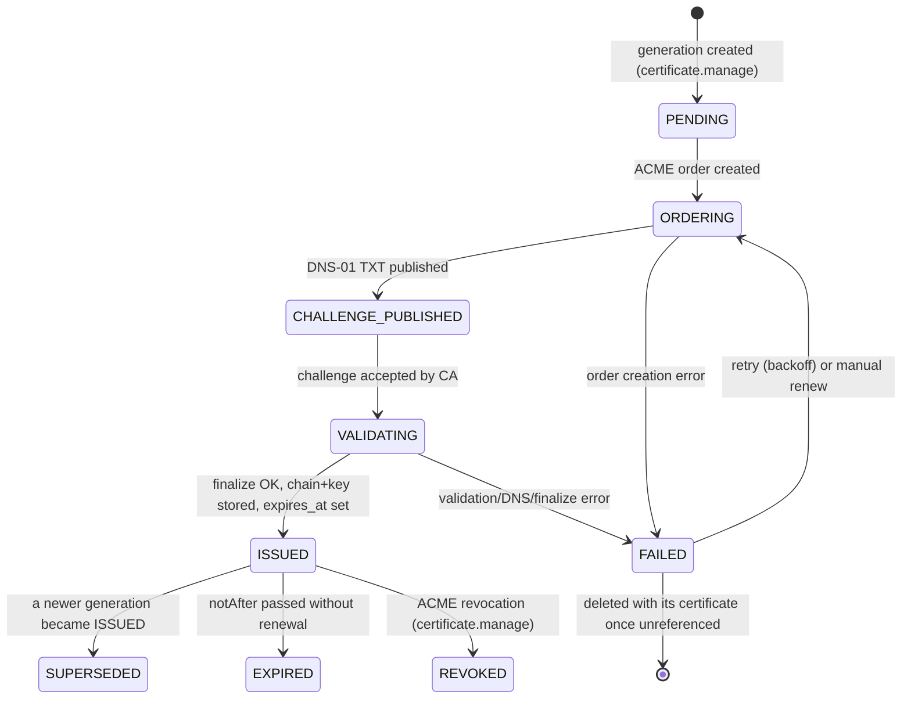

# Certificate Management — NexusOps

**Status:** Subsystem overview. **Phase 5.1 shipped** — the `certificates` and
`certificate_generations` tables, the pre-issuance lifecycle, the two permission
codenames with their role matrix, and the metadata-only certificate API (commit
`37b7211`, migration `c8d9e0f1a2b3`); **5.2.2 shipped the inputs** its issuance half needs
(2026-10-14, migration `b8c9d0e1f2a3`); **5.3 shipped issuance itself** (2026-10-16,
migration `c9d0e1f2a3`): the ACME client behind a seam, DNS-01 publication with a real
propagation check, the per-organization account registration, the order-to-material flow
with its budget and backoff, the worker and its sweep. A generation now reaches `ISSUED`
with material encrypted under the organization DEK. **Nothing is delivered**: there is
still no TLS listener, no material endpoint and no activation — the schema has no
`certificate_id` column on `routes` and `routes.scheme` is a closed CHECK of `'http'`
(`backend/app/models/routing.py`). Every remaining shape below is **Phase 5 design**, not
shipped behavior; where a shape below *is* in the tree, §1 says which slice put it there. The authoritative Phase 5 design (architecture, threat model, key
hierarchy, delivery mechanism, slices and acceptance criteria) is
[phase5-design.md](phase5-design.md); this document is the subsystem overview and defers
to it on every decision where the two differ. The **HTTP half** of the surrounding
subsystem — domains, routes, TXT verification, the nginx renderer and the `nginx.*`
operations — **shipped in Phase 4** and is described in
[domain-routing.md](domain-routing.md).
**Date:** 2026-09-21 (status updated 2026-10-16: Phase 5.1 shipped 2026-10-12; the 5.2.2
inputs — DNS credentials, ACME accounts, the generation material columns — shipped
2026-10-14, phase5-design.md §10.7; ACME issuance shipped 2026-10-16, §5 below and
phase5-design.md §10.8)
**Companions:** [phase5-design.md](phase5-design.md) · [domain-routing.md](domain-routing.md) · [domain-model.md](domain-model.md) · [multi-tenancy.md](multi-tenancy.md) · [authorization.md](authorization.md) · [node-agent-architecture.md](node-agent-architecture.md) · [secrets-architecture.md](secrets-architecture.md)

## 1. Scope and current state

**Shipped (Phase 4):** the domains and routes tables (tenant RLS plus the
platform-unique verified-name index), TXT ownership verification with the
STALE → UNVERIFIED grace lifecycle and its sweeps, the nginx renderer, the three
`nginx.*` operations, and the agent-side nginx provider with atomic apply and
rollback — **HTTP only**. See domain-routing.md §1.

**Shipped (Phase 5.1, 2026-10-12):** certificate *identity and lifecycle metadata* —
the `certificates` table (domain association, canonical primary CN, SANs, challenge
type, renewal preference, key algorithm, expiry and last-error fields), the
`certificate_generations` table limited to the pre-issuance states, the derived
certificate status, organization-scoped RLS on both tables, the
`certificate.read`/`certificate.manage` codenames with the role matrix in §3, and the
metadata-only API (request, list, inspect, update the renewal preference, delete an
unissued request). Creating a certificate records a request and its first generation;
it issues nothing, delivers nothing and activates nothing, and the API says so
(`issued: false`, `current_generation_id: null`, `expires_at: null`). See
phase5-design.md §1.1 and §10.1.1.

**Shipped since (5.2.1):** the **key envelope** — the `KEKProvider` seam, the Vault
Transit adapter, the explicitly selected deterministic test/dev provider, the
operation-scoped organization DEK (`organization_dek_envelopes.dek_ciphertext` +
`dek_generation`, always wrapped, never stored in plaintext), provider health reporting,
and the KEK-rotation rewrap path. The organization/purpose/generation binding travels as
the derivation context of a `derived=true` transit key (phase5-design.md §6.7 amendment).
**It wrapped nothing when it shipped** — no material column existed yet — so its value
then was structural: the custody path built and tested before the first key it would
hold. **5.2.2 gave it three things to wrap** (§1): a stored DNS credential, a
per-organization ACME account key, and — since 5.3 — the certificate material. All three
are now wrapped in practice: an issued generation's private key and chain are stored
under the organization DEK (§5).

**Hardened since (5.2.1.2, 2026-10-14):** the independent audit of 5.2.1 recorded four
findings, all fixed before any material column was added (phase5-design.md §10.6). The
envelope left the RLS-exempt `organizations` table (F1) — it is now a tenant table, so
PostgreSQL refuses a cross-tenant read instead of relying on the KEK provider alone; the
rewrap is compare-and-set against the envelope it read (F2), so a stale rewrap cannot
overwrite a newer one and a losing writer reloads rather than clobbers; `dek_generation`
carries the non-negative bound the design documented but had not created, alongside the
paired-column invariant (F3); and a Vault address with embedded credentials is refused at
startup (F4). None of it touches issuance, DNS credentials or delivery, which still do
not exist.

**Shipped since (5.2.2, 2026-10-14, migration `b8c9d0e1f2a3`):** the certificate
**inputs** — the `dns_providers` table and its metadata-only, write-only-secret API
(§4.2), the `acme_accounts` table with one key per organization per directory (§4.3),
and the `certificate_generations` material columns (`key_ciphertext`, `chain_ciphertext`,
`fingerprint`, `not_before`/`not_after`, `deke_id`, `issued_at`, `revoked_at`,
`revocation_state`) with the lifecycle `state` vocabulary widened to the full set
**paired** with `ck_certificate_generations_material_guard`, which requires key, chain,
`deke_id` and the validity window the moment a state stops being pre-issuance. The
columns are **empty** and nothing in the tree writes one — 5.3 is the first slice that
will. Also shipped: `certificates.dns_provider_id` (added with the table it references)
and the generation/certificate suspension pair. Credentials and account keys are wrapped
under the organization DEK with a purpose-bound payload framing, and both are new tables,
so RLS and grants apply to them like any other tenant table.

**Shipped since (5.3, 2026-10-16, migration `c9d0e1f2a3`):** **issuance**. The
`acme`/`josepy` client behind the `AcmeProvider` seam (§4.1), the per-organization
account registered with the CA once, the DNS-01 flow — order → delete the previous
attempt's leftover records → publish → **prove propagation against the authoritative
nameservers** → validate → finalize — with a fresh key pair and CSR per attempt, the
attempt budget and exponential backoff, a worker (`nx.issue_certificate`) and a 60s
sweep (`nx.sweep_certificates`) that dispatches both due and abandoned generations, the
crash-recovery order document, the `POST /certificates/{id}/retry` endpoint, the
`certificate_generations.directory_url` provenance column with its two CHECKs, and the
four issuance event types. §5 has the shipped flow; phase5-design.md §10.8 has the
per-module record and the evidence.

**Verified since (5.3.1, 2026-10-18):** two gaps the 5.3 closeout recorded are closed. First,
**issuance now completes through a real ACME server**: `tests/integration/test_certificate_pebble.py`
drives the production client adapter and the real `issue_generation()` against an isolated
Pebble CA (`docker-compose.pebble.yml`, project `nexusops-pebble`, Linux host networking) whose
DNS-01 validation queries **this repository's own authoritative server** at two loopback views —
account registration, order, DNS-01 publication, the platform's own propagation observation,
challenge validation, finalization, chain retrieval and verification, encrypted persistence,
`ISSUED` lifecycle and cleanup all happen for real. The fake-CA suite still exists and still
owns a different claim: it pins the state machine, the failure vocabulary, the backoff and the
cleanup/reference semantics, which a real CA cannot be made to produce on demand (see §11's
verification note). Second, **propagation now requires agreement rather than any one positive
answer** (§5).

**Not shipped (the rest of this document):** private-key delivery, installation, HTTPS
activation, renewal, expiry monitoring and revocation. `routes.scheme` cannot be set to
`https` and there is no `certificate_id` column, so an HTTPS route is not merely
unwired — it is unrepresentable until Phase 5.5 adds it by migration. An `ISSUED`
generation is now **written by the issuance flow** and remains **unrepresentable
without material**: the material guard CHECK rejects that row, so the guarantee 5.1 got
from a truncated CHECK is kept by a constraint. Nothing outside the control plane's own
database has seen a private key. The only TLS anywhere today is the dashboard edge
documented in docs/deployment.md, which terminates the *dashboard's* own TLS, not
customer traffic (domain-routing.md §1).

**v1 constraint, stated where HTTPS is promised:** issuance is DNS-01 only, and v1's
DNSProvider implementation is **Cloudflare only** — v1 HTTPS requires the domain's
DNS hosted on Cloudflare plus a scoped API token; other DNS providers are later
phases. This constraint is surfaced in the add-domain UI flow (platform-vision.md §4
prerequisite list) as a prompted setup step with token-scope instructions — never
discovered at certificate-request time.

What exists and is reused:

| Existing capability | Ground | Reuse here |
|---|---|---|
| Fernet helpers `encrypt_str` / `decrypt_str` / `digest_of` | `backend/app/core/security.py` | Encrypt cert chain + private key at rest; display fingerprint |
| Fernet-ciphertext-at-rest precedents | `secrets.ciphertext` (`models/secrets.py`), `server_credentials.secret_ciphertext` (`models/infra.py`), `notification_channels.config_ciphertext` (`models/notify.py`) | Same pattern for cert columns and DNS-provider credentials |
| Metadata-only reads for secret-like resources | `secret_service._detail` (`app/services/secret_service.py`), channel config write-only (`notification_service`) | Certificate API never returns key material |
| Recursive, PEM-aware redaction | `core/logging.py` — `redact_mapping` / `redact_text` / `redact_value` / `redact_log_event` (Phase 4.4: dicts, lists and tuples at any depth **and** PEM-armor content matching), applied at write in `audit_service.record` | Defense-in-depth on every leak path — **not** a license to put keys in an unsafe data path (phase5-design.md §7) |
| Beat cadences + atomic claims | `celery_app.py` `beat_schedule`; claim pattern `monitor_service` (`FOR UPDATE SKIP LOCKED`) | Renewal sweep, stuck-state sweep |
| Incident/alert pipeline | `incident_service`, `alert_service` | Issuance/expiry failures open incidents |
| Append-only audit | `audit_service.record` + DB trigger | `certificate.*` actions |
| Agent auth (`X-Agent-Token`, SHA-256 lookup) | `api/v1/agent.py` (`require_server`) | Authenticated channel for delivery ops |
| Pull-based operation control plane | shipped in Phase 1/3 — `operations` table, CAS claim/result, closed whitelist | `certificate.install` / `certificate.remove` op types (Phase 5, reference-only params) |

Honesty labels: the operations framework this document leans on **is real and shipped**
(Phase 1/3, node-agent-architecture.md §5) — it is not a spec. The certificate
subsystem's *issuance* half **is built and shipped** (5.3): the ACME client, the CA
conversation, the order and the material it produces. What the operations framework is
still *not* used for is the certificate: no `certificate.*` operation type exists, and
nothing about a certificate reaches a node. The certificate *record* shipped in Phase
5.1, the **inputs** issuance consumes — DNS credentials, the per-org ACME account key,
the generation material columns — in 5.2.2 (§1, phase5-design.md §10.7), and issuance
itself in 5.3 (§5, phase5-design.md §10.8). Earlier drafts'
`Connection`/`Integration` entity for DNS credentials does not exist in the tree;
[phase5-design.md](phase5-design.md) §3.4/§5.3 decided a dedicated `dns_providers` table,
and 5.2.2 created it — empty until an operator stores a credential, and never readable
back through the API.

## 2. Certificate entity

**In the schema, empty, and guarded (Phase 5.1 + 5.2.2).** Identity, the lifecycle
vocabulary, the material columns and the credential references exist; **no row has ever
held material**, because nothing in the tree can write one. The shipped Route table has
no `certificate_id` column and
`scheme` is a closed CHECK of `'http'` (`backend/app/models/routing.py`); Phase 5 adds
the column and widens the CHECK by migration. The design is that a Route carries an
optional `certificate_id`, so one certificate may serve many routes while a route
binds at most one (the spine ER line `Route |o--o| Certificate` understates this to
0..1:0..1; the Route table is authoritative). One row per requested certificate.

**Generation model (decided in phase5-design.md §3.2).** A certificate row is the
*identity*; each ACME order + key pair is a separate **generation** row
(`certificate_generations`, unique `(certificate_id, generation)`, at most one
non-terminal generation per certificate). Renewal inserts a new generation and marks
the old `SUPERSEDED`; it does **not** overwrite the material in place. Earlier drafts
of this document said renewal reuses the row and replaces `chain_ciphertext` — that is
corrected: keeping generations separate is what makes "an older generation must not
replace a newer one" a structural property rather than a comparison the code must
remember.

| Field | Type | Notes |
|---|---|---|
| `org_id` | UUID FK, NOT NULL | Tenant root; session guard applies (multi-tenancy.md §3) |
| `primary_cn` | String | Subject CN, e.g. `api.example.com` or `*.example.com` |
| `sans` | JSONB list | Additional identifiers on the order (e.g. apex + wildcard) |
| `status` | String + CHECK | Certificate-level view: `PENDING`/`ISSUED`/`FAILED`/`EXPIRED`/`SUSPENDED`/`REVOCATION_PENDING`/`REVOKED`/`REVOKED_LOCAL_ONLY`; `state` (material) and `revocation_state` (CA) are separate axes (phase5-design.md §2.2/§9.3) |
| `challenge_type` | String + CHECK | `dns-01` only in v1; `http-01` is a later fallback, not offered (phase5-design.md §5.2/§5.7) |
| `auto_renew` | Bool | Renewal scan skips rows with false |
| `dns_provider_id` | UUID FK → `dns_providers` | DNSProvider creds for DNS-01; defaults from the Domain (phase5-design.md §3.4/§5.3) |
| `issued_at`, `expires_at` | DateTime | From the issued cert's notBefore/notAfter |
| `chain_ciphertext` | Text | Fernet(**org DEK**, phase5-design.md §6) of `fullchain.pem` — on the generation row, not the certificate row |
| `key_ciphertext` | Text | Fernet(**org DEK**) of `privkey.pem` — generation row |
| `fingerprint` | String | SHA-256 of the leaf DER — display + change detection, never a decryption oracle (like `digest_of`) |
| `order_state` | JSONB | ACME order/challenge URLs, key authorizations, TXT record refs (public ACME data, no keys) |
| `last_error` | Text nullable | Sanitized failure reason of the current generation's last attempt |
| `next_attempt_at` | DateTime nullable | Backoff cursor for failed attempts |
| `attempt_count` | Int | Reset to 0 on success; drives backoff + give-up |

> **Ownership note:** the ciphertext columns, `fingerprint`, `order_state` and the
> attempt cursors live on `certificate_generations` (one ACME order + key pair), not on
> `certificates`. `certificates` holds identity (`primary_cn`, `sans`,
> `dns_provider_id`, `auto_renew`) and a denormalized `status`/
> `current_generation_id`/`expires_at`. Full column/index/constraint list:
> phase5-design.md §3.
>
> **What of this table is in the tree (5.2.2):** every column above is — `status`,
> `challenge_type`, `auto_renew`, `dns_provider_id`, `issued_at`, `expires_at`,
> `chain_ciphertext`, `key_ciphertext`, `fingerprint`, `order_state`, `last_error`,
> `next_attempt_at`, `attempt_count` — as are `deke_id`, `not_before`, `not_after` and
> `revocation_state`, the generation-level fields the rows above do not list, plus the
> generation/certificate suspension pair. What is **not** shipped is every *write* to the
> material ones: `key_ciphertext` and `chain_ciphertext` are empty, and
> `ck_certificate_generations_material_guard` refuses any non-pre-issuance state that
> lacks them (with `deke_id`, `issued_at`, `not_before`, `not_after`). `expires_at` is
> likewise NULL until an issuance sets it.

Certificate **status** is a denormalized view of the current generation; the status
machine below describes a single **generation** (phase5-design.md §2.2), which is what
renewal creates and supersedes. Renewal does not re-enter `validating` on the same row:



Certificate is referenced by `routes.certificate_id` (domain-model.md §2.4). A
certificate row is never hard-deleted while any route references it (RESTRICT, same
policy as roles); delete is allowed only when orphaned.

## 3. API surface and permissions

**Shipped today (5.1 + 5.2.2 + 5.3):** `POST`, `GET /certificates`, `GET /certificates/{id}`,
`PATCH` (`auto_renew`, `dns_provider_id`), `DELETE`, `POST /certificates/{id}/retry`, plus
the whole `/dns-providers` surface (`dns_providers.py`) — reads under
`certificate.read`, every mutation under `certificate.manage`, both organization-scoped.
`POST` records the request, writes its first `PENDING` generation and hands that
generation to the worker **after the transaction commits**; `POST /{id}/retry` answers
`202 Accepted`, pulls the next attempt's schedule forward and dispatches the same task,
refusing with a named code instead of pretending (`CERTIFICATE_ALREADY_ISSUED`,
`CERTIFICATE_ATTEMPTS_EXHAUSTED`, `CERTIFICATE_ATTEMPT_IN_FLIGHT`,
`CERTIFICATE_STATE_NOT_ATTEMPTABLE`, `CERTIFICATE_NO_GENERATION`). The `renew`, `revoke`
and `/{id}/routes` rows below are **design** (5.4–5.6), and `POST`/`GET` do not contain
the delivery fields this table's design-era wording implies — the authoritative shipped
shape is docs/api.md §6.

Codenames per authorization.md §2: `certificate.read`, `certificate.manage` —
**registered in Phase 5.1** (`backend/app/core/permissions.py`, seeded into the stored
roles by migration `c8d9e0f1a2b3`). **Role matrix (implemented):** with the
current stored role names (the `Operator` → `DevOps` rename is *not* shipped),
Owner/Admin/**Operator** hold `certificate.read` + `certificate.manage`, and
Developer/Viewer hold `certificate.read` only. Both are organization-scoped, and reads
remain **metadata-only** — no endpoint returns a private key, plaintext certificate
material or ciphertext (phase5-design.md §4.1). No `node.execute` is introduced;
delivery rides whitelisted Operation types (§6) gated by `certificate.manage` +
the `nginx` capability.

| Endpoint | Gate | Behavior |
|---|---|---|
| `POST /certificates` | `certificate.manage` | Create row, enqueue issuance (after commit) |
| `GET /certificates` | `certificate.read` | Metadata-only list (org-scoped) |
| `GET /certificates/{id}` | `certificate.read` | Metadata + fingerprint + status + expiry + each generation's `directory_url`/`directory`/`publicly_trusted`; **no ciphertext, ever** |
| `POST /certificates/{id}/retry` | `certificate.manage` | Pull the next attempt forward and dispatch it — `202 Accepted`, or a named 409 refusal |
| `POST /certificates/{id}/renew` | `certificate.manage` | Force reissue outside the window (5.6) |
| `POST /certificates/{id}/revoke` | `certificate.manage` | ACME revocation; delivers removal ops |
| `DELETE /certificates/{id}` | `certificate.manage` | Only when no routes reference it |
| `GET /certificates/{id}/routes` | `certificate.read` | Routes serving this cert (= delivery targets) |

All routes run under `X-Org-Id` resolution and the session guard (multi-tenancy.md §2-3);
every mutation audits (§12).

## 4. ACME architecture

**The control plane is the ACME client.** Issuance runs in the API/Celery worker, never
on nodes. Rationale: DNS API creds never leave the control plane; rate-limit state is
tracked in one place; NAT-ed nodes cannot answer challenges themselves; key generation
and storage are centralized.

**Shipped (5.3):** the client is the maintained `acme`/`josepy` library
(`acme>=5.1`, `josepy>=2.2`, O2 in phase5-design.md §10.3.3), reached only through
`app/services/acme/` — `directory.py` (the closed directory set and the
`assert_issuance_allowed` gate), `library.py` (the client adapter) and `__init__.py`
(the `AcmeProvider` seam, `open_acme_session`, and the typed error families
`AcmeRejected` / `AcmeRateLimited` / `AcmeTimeout` / `AcmeUnavailable` / `AcmeConfigError`
with `classify_error` and a bounded `sanitize_detail`). Nothing outside that package
imports the library, so a version bump is one module's problem. The gate that refuses
issuance outside the configured directory is re-applied **where the socket is opened**,
not only at startup: a production directory reached from a test or a development process
is not recoverable — real rate limits, real certificates for names nobody asked for.

### 4.1 DNS-01 first (the default and the wedge)

DNS-01 is the only challenge type in v1 because it is the only one that works for the
platform's wedge (platform-vision.md §2.2): home servers behind NAT with no inbound
port 80, Raspberry Pis, and wildcard names. It requires no inbound connectivity to the
node at issuance time — the proof is a TXT record, not an open port.

### 4.2 DNSProvider interface

Providers over couplings (platform-vision.md §3.6). One interface, first implementation
Cloudflare:

| Method | Purpose |
|---|---|
| `create_txt(zone, name, value, ttl)` | Publish `_acme-challenge.<name>` |
| `delete_txt(zone, name, value)` | Cleanup after validation (best-effort) |
| `propagation_check(name, value, deadline)` | Query authoritative NS before telling ACME "ready" |
| `verify_creds()` | Health check on save |

- **The record half shipped in 5.3** as a **separate protocol** (`DnsRecordProvider`,
  obtained from `records_provider_for`): `resolve_zone(credentials, name)`,
  `create_txt(...)` returning a record **reference**, `find_txt(...)` and
  `delete_txt(record_ref)`. Separate from `verify_creds` on purpose — no
  credential-verification call site can acquire the ability to write a record, and the
  verification fakes stay valid. Notable properties: cleanup deletes by the returned
  reference, never by re-deriving the name (a challenge name legitimately holds several
  TXT values at once, so "delete the TXT at this name" is never performed); a write whose
  response was lost is `DnsWriteAmbiguous`, resolved by **observing** the zone rather than
  by retrying blind; and `DnsProviderUnavailable` (retryable) is distinct from
  `DnsProviderRejected` (an operator has to change the credential or the allowlist).
  **Propagation is not a provider method** (see §5): the platform asks the name's
  authoritative nameservers, because that is the question the CA will ask.
- **Shipped in 5.2.2** — credentials live in the dedicated **`dns_providers` table**
  (`org_id`, `name`,
  `kind`, `credentials_ciphertext`, `credential_fingerprint`, `deke_id`, `scopes`,
  `zone_allowlist`, `verified_at`, `auto_cleanup`, `last_used_at`) — Fernet(**org DEK**)-encrypted whole, write-only via
  the API, metadata-only reads: the pattern proven by notification channel config and
  secret metadata. `verify_creds()` runs on save  and on `POST /dns-providers/{id}/verify`
  and only records its verdict (a failing credential is stored, not rejected); the record
  operations shipped in 5.3 under the separate protocol above. A Cloudflare API token
  **scoped to the zone** is the v1 credential
  shape, and `zone_allowlist` is enforced before any provider call. Rationale for a
  dedicated table (vs reusing deployment-resolvable secrets or a notification channel)
  and cleanup/validation rules: phase5-design.md §3.4/§5.3. **A customer DNS token must
  never be delivered to a node.**
- **No Domain row carries a credential.** §3.4 and this section's earlier wording
  described a `domains.dns_provider_id` a certificate would inherit; **no migration ever
  created that column**, and 5.3 records the correction rather than implementing the
  inheritance (phase5-design.md §10.8.1). The certificate's own `dns_provider_id` is the
  only reference that exists, and issuance refuses a certificate that names none with
  `CERTIFICATE_DNS_CREDENTIAL_MISSING` until `PATCH /certificates/{id}` attaches one.
- Later implementations (Route53, DigitalOcean, ...) add a class, a kind enum value,
  and nothing else.

### 4.3 ACME account and directory

- Directory URL is configuration: Let's Encrypt production plus **staging**, which is
  the default for all non-production environments and for tests — staging exempts
  development from production rate limits. **Staging is the default; production
  issuance requires explicit production configuration and never silently falls back to
  staging**, and a staging-issued certificate is never presented as a production one
  (phase5-design.md §5.4).
- **Shipped in 5.3:** the vocabulary has a third member, **`pebble`** — the local test CA
  at Pebble's documented default (`https://localhost:14000/dir`), **fixed in the enum
  rather than configured**, so no environment variable can point a value called "pebble"
  at a real CA. `ACME_DIRECTORY` (`staging` | `production` | `pebble`, empty meaning
  staging outside production and refused in production) is validated by one startup
  validator that refuses an unknown name, `pebble` in production, production outside
  production, and an unset value in production. TLS verification is relaxed for exactly
  the `pebble` member, in exactly one place, and `AcmeDirectory.is_publicly_trusted` is the
  single predicate the API derives "publicly trusted" from. The generation records the
  directory URL it was ordered at (§5), so the answer survives a reconfiguration.
- One ACME account per Organization per directory (staging and production are
  separate accounts). **Shipped in 5.2.2:** the `acme_accounts` row and its key custody —
  `org_id`, `directory_url`, `key_ciphertext` Fernet(**org DEK**) with `deke_id`,
  `key_fingerprint` over the **public** half, `key_algorithm` fixed at P-256 and never
  caller-chosen, unique per `(org_id, directory_url)` so two concurrent first uses
  converge on one row. Per-org accounts keep rate-limit blast radius
  and revocation ownership scoped to the tenant (phase5-design.md §5.4). **Registration
  with the CA shipped in 5.3**: an attempt registers the account once and records the
  CA's `kid`; `record_registration()` refuses a repoint, so one organization's account
  cannot be quietly swapped for another URL's. The key is decrypted for one operation
  (`account_key`) and is reachable from no route; there is no default directory, and an
  unknown one is a 422 naming the closed set.

### 4.4 HTTP-01 via node nginx (later fallback)

HTTP-01 requires Let's Encrypt to reach the node on port 80 — it serves only nodes with
public DNS + inbound 80, and cannot issue wildcards. It is a **later-phase fallback**
for orgs that do not want to hand out DNS API credentials: the control plane renders a
temporary challenge location into the node's nginx config via the existing nginx
render/apply operation path (ProxyProvider, domain-model.md §2.4; spec:
node-agent-architecture.md), the node answers the probe, and the flow proceeds
identically from finalization onward. DNS-01 remains the default; no UI promotes
HTTP-01 in v1.

## 5. Issuance flow

`request → order → challenge → issue → store → deliver`. One Celery task per attempt,
idempotent, driven by the row's status + `next_attempt_at`.

```mermaid
sequenceDiagram
    participant U as DevOps (certificate.manage)
    participant A as API
    participant W as Celery worker
    participant AC as ACME (Let's Encrypt)
    participant DNS as DNSProvider (Cloudflare)
    participant AG as Node agent

    U->>A: POST /certificates (cn, sans, dns_provider_id, auto_renew)
    A->>A: Certificate row status=pending + audit certificate.created
    A->>W: enqueue nx.issue_certificate
    W->>AC: newOrder (identifiers)
    W->>W: load org ACME account (Integration, Fernet)
    AC-->>W: order URL + dns-01 challenges (token, key authz)
    W->>DNS: create_txt(_acme-challenge.<name>, digest)
    W->>DNS: propagation_check until authoritative NS answer
    W->>AC: challenge ready (notify)
    W->>AC: poll order status
    AC-->>W: valid
    W->>AC: finalize (CSR)
    AC-->>W: certificate chain
    W->>W: encrypt_str chain+key -> ciphertext columns; expires_at; fingerprint
    W->>W: status=issued, audit certificate.issued
    W->>W: delivery fan-out (section 6)
    Note over AG: agent PULLS ops; no push, no tunnel
    AG->>A: GET next operation (X-Agent-Token)
    A-->>AG: certificate.install payload (chain + key, over agent TLS)
    AG->>AG: write key 0600 / chain 0644, render nginx, nginx -t, atomic apply
    AG->>A: report result
    A->>A: audit certificate.deployed (per node)
```

Failure at any ACME/DNS step writes `last_error` (sanitized), sets `next_attempt_at`
with backoff, and keeps the row in `failed` on give-up (§11).

### 5.1 Shipped (5.3): the flow as it actually runs

**The order of an attempt is the contract** (`app/services/certificate_issuance.py`), and
it is built so a failure leaves the platform able to say what happened without stranding
anything in a customer's zone:

1. **Refusals first, before the attempt is stamped.** A material-bearing or terminal
generation, a document written by a version this code cannot read, or a spent budget is
not an attempt — recording a *failure* for one of them would overwrite the reason an
operator needs.
2. **A durable attempt stamp.** A live state (`ORDERING` … `VALIDATING`) says an order is
open; it does not say a worker is running it. The attempt pair written to the order
document — committed, not merely flushed, so a second worker's transaction can see it —
is what makes that answerable. A dispatch that arrives while another worker runs is
refused (`CERTIFICATE_ATTEMPT_IN_FLIGHT`); one that arrives after a worker died is
recovered as a **failure** (`CERTIFICATE_WORKER_LOST`) with the backoff, never silently
resumed; one that arrives before the backoff has elapsed is refused
(`CERTIFICATE_NOT_DUE`).
3. **The previous attempt's leftovers are deleted first.** Cleanup runs before
publication, through the same code path a failure runs, so a replaced order's TXT value
cannot coexist with the new one at the same name.
4. **Context is resolved inside the attempt**: the domain must still be `VERIFIED`, the
certificate must name a DNS credential that decrypts, the identifiers are
re-canonicalised from the row (bounded, deduplicated, wildcard-allowed), and the
generation's recorded directory must be the one configured now — a retry at another CA is
a new certificate request, not a relabelled row (`CERTIFICATE_DIRECTORY_CHANGED`).
5. **A fresh key pair and CSR per attempt.** An attempt cannot resume an earlier order:
the CSR is bound to a key that exists only in that process, and persisting it would mean
storing material for a generation that is not yet issued — exactly what the material guard
forbids. So each attempt re-orders; `reset_challenges` replaces the order document's
entries while keeping every reference to a record that still has to be deleted.
6. **Publish, then prove.** `create_txt` through the provider seam, then
`app/services/dns_propagation.py` asks the name's **authoritative nameservers** until the
expected value is visible or the deadline passes. The rule is **agreement, not any one
answer**: every authority that answered must serve every expected value before the flow
tells the CA a challenge is ready. A disagreement (one server has the value, another
answered without it) is mid-propagation, and the poll keeps waiting — a single positive
answer no longer overrides a stale sibling. A server that **did not answer** (timeout,
SERVFAIL, transport error) is a separate fact: it is recorded per server, reported, and
does not by itself block readiness, because the platform cannot observe a value a server
refuses to serve. A negative answer is never final while time remains, the deadline is
hard and bounded, and an operator's manual confirmation uses this same check — a claim is
not an observation (phase5-design.md §5.3). This is the step the design sketched as a
`propagation_check` provider method; it shipped as a platform-side loop instead
(phase5-design.md §10.8.1), because the question is about the name's DNS rather than the
provider's API.
7. **Validate, finalize, verify, encrypt — then move the state.** The chain is downloaded,
parsed, matched against **this attempt's own key** and its identifier list (a chain missing
a requested name or carrying another key is `CERTIFICATE_MATERIAL_MISMATCH`), and encrypted
under the organization DEK with a purpose-bound payload *before* any row claims
`ISSUED`. There is no window in which a row claims material it does not have.
8. **Then clean up and publish the outcome.** Success emits `CERTIFICATE_ISSUED` and the
`certificate.issued` audit entry; a failure is recorded durably (code, sanitized text,
`next_attempt_at`) *before* cleanup runs, so a slow DNS call cannot cost the record of
what went wrong. Cleanup is best-effort and reports honestly when it could not confirm a
record is gone.

**Budget, backoff, cadence.** Five attempts per generation (`MAX_ISSUE_ATTEMPTS`, shared
with §7's renewal budget), exponential backoff from 5 minutes capped at 24 hours, and no
retry *inside* an attempt — one attempt is one bounded conversation. The CA's own
`Retry-After` is honored and never shortened. `nx.issue_certificate` is keyed by the
generation row and runs one attempt; `nx.sweep_certificates` runs every 60s and dispatches
due generations **and** abandoned ones (a live state whose attempt is older than
the order TTL, 3600s) in a bounded batch of 50 — it writes nothing, so one writer stays in
charge of a generation's state. The TTL is deliberately much longer than any legitimate
attempt: recovering a live attempt would be a second order for one generation.

**Provenance.** The generation records the directory URL its order was created at,
written when the attempt starts and never rewritten, with two CHECKs beside it (NULL or a
vocabulary URL; material-bearing ⇒ not NULL). The API derives `directory` and
`publicly_trusted` from that stored URL rather than from current configuration, so a
staging generation stays labelled staging after the platform is pointed at production and
an unrecognised URL reads as **not** publicly trusted.

## 6. Delivery to serving nodes

**Secret minimization.** The delivery target set is derived, never configured:
`routes` where `certificate_id = cert.id` and `enabled = true` — their distinct
`node_id`s. A node receives a certificate only if it serves a route using it
(domain-model.md §3.7). Adding a route to an already-issued certificate enqueues one
delivery; removing the last route using it on a node enqueues a `certificate.remove`.

Delivery is an **Operation** (whitelisted type — the agent pulls; no remote shell):

| Op type | Params (at rest) | Effect on node |
|---|---|---|
| `certificate.install` | `{certificate_id, generation, fingerprint}` — reference only | Material is fetched from the dedicated delivery endpoint (below); writes `privkey.pem` 0600, `fullchain.pem` 0644 under a **content-addressed** `/etc/nexusops/tls/<fingerprint>/`; then the existing `nginx.apply` path renders the TLS block and applies it atomically with rollback |
| `certificate.remove` | `{certificate_id, generation}` | Drops the generation's managed directory; applies a config without it |

Key property: **private key material is never persisted in the Operation row, its
params, its result, events, audit metadata or logs.** Params hold a reference. The
material is served by a **dedicated, narrowly scoped endpoint** —
`POST /agent/certificates/{delivery_id}/material`, bound to the authenticated node and
its organization, to the specific certificate/generation, and to a bounded recovery
window; the body is assembled at read time (`decrypt_str(key_ciphertext)` inside the
request) with `Cache-Control: no-store`, and is never stored. Op results carry
success/failure and a fingerprint only. Full mechanism, replay/supersession rules and
leak-path table: **phase5-design.md §7**. Redaction (`core/logging.py`) is
defense-in-depth, not the control.

**Issuance success is not activation.** A certificate can be `ISSUED` at the control
plane while every serving node is offline. The platform reports six distinct stages —
issued, delivered, installed, applied, verified, active (phase5-design.md §2) — and
never equates issuance with a working HTTPS endpoint.

Failure semantics: the op retries while the node is offline (standard Operation queue
behavior, node-agent-architecture.md); a cert whose deliveries are all pending shows
`issued` but the routes page surfaces delivery state per node. HTTP keeps serving until
the HTTPS endpoint has been independently verified (phase5-design.md §5.6).

## 7. Renewal

A beat-driven sweep, built on the platform's existing cadence pattern
(celery_app.py:47-93 fixed ticks; atomic claim via `FOR UPDATE SKIP LOCKED`,
monitor_service.py:293-313):

| Beat entry | Cadence | Work |
|---|---|---|
| `sweep-certificates` **(shipped in 5.3, 60s** — due and abandoned **issuance** dispatches, §5.1) | 60s | Dispatch generations that are due an attempt and live ones whose worker died |
| *renewal sweep* (5.6, name not yet taken) | hourly | Claim certificates `auto_renew AND current generation ISSUED AND not_after < now() + 30 days`; enqueue a **new generation** (same flow as §5) |

> The 5.3 issuance sweep took the `sweep-certificates` name, so the 5.6 renewal sweep
> needs its own beat entry rather than a second schedule for the same task name — and the
> retry/due half of the design's original two-row table is what the 5.3 sweep already
> does (a failed generation with an elapsed backoff is dispatched by the same tick).

Renewal creates a **new generation** (new ACME order + new key pair) and marks the
previous generation `SUPERSEDED`, in one transaction; then it re-runs delivery to the
currently-derived target set. The old material stays installed and serving on nodes
until the new one is delivered and applied, since renewal starts 30 days before
expiry. An older generation can never replace a newer one: the generation is immutable
once issued, paths are content-addressed by fingerprint, and a `SUPERSEDED` generation
refuses delivery (phase5-design.md §8.5). A node that is offline during renewal stays
`PENDING` and converges on its next heartbeat — the state is visible, not a silent
success (phase5-design.md §8.6).

- **Failure alerts + incident.** An attempt that exhausts its budget (§11) raises
  `certificate.failed` → CRITICAL alert via the existing alert mapping
  (alert_service.py:17-29) and opens an incident through the incident pipeline
  (incident_service.py:104-246); resolution happens automatically when a later attempt
  succeeds, mirroring monitor auto-resolve (monitor_service.py:377-397).
- **Expiry breach.** If `expires_at` passes with renewal still failing, the sweep sets
  `status=expired` — a CRITICAL state surfaced by the TLS-expiry monitor (§10) rather
  than a second incident path.
- Manual `POST /certificates/{id}/renew` bypasses the 30-day window for ops drill-down;
  it is audited like any issuance.

## 8. Wildcard certificates

- **DNS-01 only.** Let's Encrypt validates wildcard identifiers exclusively via DNS-01;
  HTTP-01 cannot issue them. A wildcard request with `challenge_type=http01` is
  rejected at create time.
- **One label deep.** `*.example.com` matches `api.example.com` but not
  `a.b.example.com`. The common v1 shape is a single order for both identifiers —
  `sans = ["example.com", "*.example.com"]` — so apex and any first-level subdomain
  share one cert; both identifiers validate via their own `_acme-challenge` TXT record
  (the DNSProvider interface takes the full challenge name, so no special casing).
- **Route binding.** A route's hostname may bind a certificate whose CN/SANs cover it.
  Matching is exact-or-wildcard; this subsystem owns both the covering check and the
  reject-on-mismatch at bind time (Open question 3).
- **Renewal and delivery are identical** to non-wildcard certs — the wildcard lives in
  the identifiers, not the pipeline. Serving a wildcard from a node means every route
  on that node using the covered name shares one key; delivery minimization (§6)
  already collapses that to one install op per node.

## 9. Storage and leak paths

**Phase 5 target (not the current secret-store path):** certificate and DNS-credential
ciphertext is Fernet under a **per-organization DEK**, itself wrapped under the KEK and
stored in the organization's row of `organization_dek_envelopes` (a tenant table behind
RLS — not on the RLS-exempt `organizations` row, where 5.2.1 first put it; §10.6 of
phase5-design.md). `decrypt_str` fails
closed on a mismatch. This does **not** re-encrypt the existing secret store — secrets,
`secret_versions`, `server_credentials` and channel configs keep the current single-key
path (`backend/app/core/security.py`), and migrating them is a separate reviewed change.
The full key hierarchy, threat model, rotation, backup and recovery rules are in
**phase5-design.md §6**; in particular, a per-org envelope does **not** bound a
compromise of the KEK or of the application runtime.

| Path | Guarantee | Enforcement |
|---|---|---|
| REST responses | Metadata only: CN, SANs, status, dates, fingerprint — **no ciphertext field** | Schemas define no ciphertext field (pattern: `secret_service._detail` metadata-only) |
| Operation rows at rest | Reference `{certificate_id, generation, fingerprint}` only, no key material | §6; the dedicated material endpoint assembles the body at read time |
| Operation results / history API | success/failure + fingerprint only | Op result schema; params *are* reference-only, so the history endpoint is safe by construction |
| Logs | No PEM/key contents | Phase 4.4 recursive, PEM-aware redaction (`core/logging.py`) runs on every structlog record — **defense in depth**; issuance code never logs payload values |
| Audit metadata | No key material | `redact_mapping` applied at write (`audit_service.record`); audited actions carry ids + fingerprint only |
| WS / events | No cert channel publishes material | `certificate.*` event frames carry ids, status, node ids (event_bus frame shape) |
| Frontend | types carry metadata fields only | Hand-mirrored types.ts gains no ciphertext field |
| DB at rest | `chain_ciphertext`, `key_ciphertext` Fernet(org DEK) columns **on the generation** | §2/§9; read paths limited to issuance write + the delivery endpoint's read |

`fingerprint` (SHA-256, truncated) is the only value-derived field any API returns —
display/change-detection use, never a decryption oracle, same reasoning as
`digest_of` (`backend/app/core/security.py`).

## 10. Status/expiry tracking and monitor tie-in

- `expires_at` is set from the issued cert's `notAfter` at store time. The
  `sweep-certificates` pass also flips `issued` → `expired` when it passes, and marks
  orphaned `failed` rows deletable.
- **TLS-expiry monitors.** domain-model.md §2.6 makes Monitor polymorphic
  (target node/container/domain/certificate/url) with auto-attach on domain routes
  (opt-out). Every certificate gets one `certificate`-target monitor on issuance:
  the check is `days_remaining = expires_at - now()` evaluated against warning/critical
  thresholds (default warn 21d, critical 7d) and rides the existing engine —
  check scheduling, incident open/acknowledge/resolve, notification fan-out are all
  unchanged monitor machinery, not new code. Dedup: the certificate-target monitor is
  the expiry-tracking owner — the TLS-expiry monitor a route's auto-attach would create
  (domain-model.md §2.6) is skipped when the route's bound certificate already has its
  issuance-time monitor, so a cert serving routes ends up with a single expiry monitor
  and a route-less cert is still covered by its own.
- Uptime monitoring of the *served* hostname is the domain/route monitor's job
  (domain-model.md §2.6); certificate expiry and route availability fail independently
  and page through the same incident pipeline.
- The certificate detail page renders the monitor's state inline; Viewer
  (`certificate.read`) sees it read-only.

## 11. Failure handling

Attempt budget: 5 attempts per issuance/renewal cycle, exponential backoff
(`2^n * 5 min`, cap 24h — same shape as the notification retry ladder,
notification_service.py:44-46). Exhaustion → `failed`, alert + incident (§7).

**Shipped in 5.3:** every way an attempt can stop without a certificate has a stable
**code** (`last_error` carries it, and only the text beside it is prose):
`CERTIFICATE_CONTEXT_INCOMPLETE`, `CERTIFICATE_DNS_CREDENTIAL_MISSING`,
`DOMAIN_NOT_VERIFIED`, `CERTIFICATE_DIRECTORY_CHANGED`, `CERTIFICATE_ORDER_MISMATCH`,
`CERTIFICATE_ORDER_LOST`, `CERTIFICATE_MATERIAL_MISMATCH`,
`CERTIFICATE_ORDER_DOCUMENT_UNSUPPORTED`, `CERTIFICATE_ATTEMPT_ERROR`,
`CERTIFICATE_WORKER_LOST`, plus the CA-side families
(`AcmeRejected`/`AcmeRateLimited`/`AcmeTimeout`/`AcmeUnavailable`). A failure is
recorded **before** TXT cleanup runs, so a slow or broken DNS call cannot cost the
record of what went wrong, and cleanup reports honestly when it could not confirm a
record is gone rather than claiming success (`CERTIFICATE_ORDER_LOST` is the
corresponding read-side refusal: a document missing what the attempt needs is never
guessed at). An attempt that this code cannot classify is recorded by class name only
— never by message, which could quote a request or a URL — and logged with its
traceback in the worker's log.

| Failure class | Detection | Handling |
|---|---|---|
| DNS API auth/permission error (Cloudflare 403, revoked/under-scoped token) | `create_txt` / `verify_creds` status (`DnsProviderRejected`, not retryable) | Attempt fails with a classified reason surfaced in `last_error` and the UI; no retry until the credential is fixed — backoff still applies, so fixing the token heals automatically |
| DNS API outage (5xx / timeout) | Provider call (`DnsProviderUnavailable`, retryable) | Retry with backoff; the propagation check has a hard deadline so a slow API cannot hang the worker |
| Ambiguous DNS write (timeout/5xx after the write may have committed) | `DnsWriteAmbiguous` | **Not** retried blind: the zone is observed (`find_txt`) to learn whether this platform's record exists, because a second create would leave two records and make cleanup guess |
| Propagation never visible | Authoritative-NS poll deadline (`dns_propagation.py`) | Fail attempt with `DNS_TIMEOUT` (retryable), best-effort `delete_txt` cleanup by record reference, retry |
| Authoritative servers disagree (one serves the value, another answered without it) | Per-server answers from the same poll (`PropagationResult.nameserver_answers`) | **Not** treated as propagated: the poll keeps observing until every answering authority agrees or the deadline passes, then fails as above. An unreachable server is recorded as unreachable rather than counted as agreement |
| ACME validation rejected (bad TXT, CAA, challenge mismatch) | Order status invalid | Fail attempt; retry only after cleanup — re-setting the same wrong record wastes the per-name failed-validation budget |
| Let's Encrypt rate limits (new-orders per account window, duplicate-certificate per week, failed validations per hostname/hour) | ACME error type + `Retry-After` | Honor `Retry-After` exactly; suppress retries beyond the budget; staging directory for all pre-production use keeps production budget clean |
| Order/account errors (expired order, rejected account key) | ACME status | Account errors re-run registration (new keypair Integration) once; otherwise fail |
| Stuck live state (worker died mid-order) | The attempt stamp in the order document, older than the order TTL (3600s) — read by both the sweep and the service with the same predicate | Recorded as a **failure** with `CERTIFICATE_WORKER_LOST` ("the platform lost a worker", not "a CA refused"), best-effort TXT cleanup by record reference, then the normal backoff |
| Stuck deliveries (node offline) | Operation queue | Ops retry while node offline; `certificate.remove` for a decommissioned node is dropped by the op sweeper (node gone, nothing to remove) |
| DEK/KEK mismatch at decrypt | `decrypt_str` ValueError | Delivery fails closed — the endpoint reports failure, never ships a broken payload; a generation whose material cannot be decrypted is re-issued (§6.5) |

No partial state: a generation's ciphertext columns are written in one transaction and
never rewritten (renewal inserts a new generation), and node files are written to temp
paths then atomically moved only after `nginx -t` passes (the shipped Phase 4
stage → validate → backup → swap → reload → rollback pipeline,
phase5-design.md §8.4).

**Verification — two suites, two claims (5.3.1).** Neither suite substitutes for the
other, and the commands are separate so a run says which claim it made:

| Command | Infrastructure | What it proves |
|---|---|---|
| `make test-backend` | PostgreSQL + Redis | everything, including both suites below through the ordinary run |
| `make test-backend-unit` | none | the pure pieces: the order document, the propagation fold, the ACME seam, the attempt's helpers |
| `make test-backend` → `tests/integration/test_certificate_issuance.py` | PostgreSQL + Redis | the **flow** with a fake CA session, fake zone and fake observer: success, the CA-side failure families, backoff, cleanup reference semantics, duplicate dispatch, manual retry |
| `make test-pebble` → `tests/integration/test_certificate_pebble.py` | the isolated Pebble + two-view authoritative-DNS stack (`docker-compose.pebble.yml`) plus PostgreSQL + Redis | **interoperability**: a certificate really is issued by a CA that really resolves the challenge name, and the flow's own propagation observation is what lets it validate |

The Pebble suite does **not** skip when its stack is missing: a missing Docker daemon, a
failed `up` or an unreachable directory is a failure naming `make pebble-up`. Pebble's TLS
certificate is self-signed and regenerated per start, so it is trusted nowhere but the
`pebble` client path; its test root is never installed into a system or production trust
store, and no Pebble container is ever pointed at by a deployed `ACME_DIRECTORY` (the
startup validator refuses it in production).

## 12. Audit and events

**Shipped in 5.3:** the audit actions below marked *(shipped)* are written by the
issuance flow today — `certificate.issued` by the worker when the chain is stored, and
`certificate.issuance_retried` when an operator pulls an attempt forward. The rest belong
to the later slices. The shipped event types are `CERTIFICATE_ISSUED`,
`CERTIFICATE_ISSUANCE_FAILED` (one attempt; retries may remain — a **warning** alert),
`CERTIFICATE_ISSUANCE_RETRIED`, and `CERTIFICATE_FAILED` (the budget is spent and nobody
is working on it — a **critical** alert, because only a human can decide what happens
next). Which is which is decided in `alert_service` by set membership, so adding a type
to the wrong set is a deliberate edit rather than an accident of naming.

Audit actions (append-only, org-attributed once tenancy lands, named per the
`resource.action` convention in domain-model.md §2.6):

| Action | On | Actor |
|---|---|---|
| `certificate.created` | Create | user |
| `certificate.issued` *(shipped, 5.3)* | Chain stored | system (worker) |
| `certificate.issuance_retried` *(shipped, 5.3)* | Operator pulled the next attempt forward | user |
| `certificate.renewed` | Renewal chain stored | system (worker) |
| `certificate.failed` | Attempt budget exhausted | system (worker) |
| `certificate.deployed` | Node reports install success | agent |
| `certificate.removed` | Node reports removal | agent |
| `certificate.suspended` | Ownership lost / operator suspension | system (worker) / user |
| `certificate.ownership_lost` | Cross-org ownership flip affecting this cert | system (worker) |
| `certificate.split` | Shared cert replaced/split before revocation | system (worker) |
| `certificate.revocation_requested` | Revocation queued (automated or manual) | system / user |
| `certificate.revoked` | ACME revocation acknowledged | system / user |
| `certificate.revocation_failed` | CA unreachable/rejected at the retry budget | system (worker) |
| `certificate.deleted` | Row deleted | user |

SystemEvent equivalents (`CERTIFICATE_ISSUED`, `CERTIFICATE_ISSUANCE_FAILED`,
`CERTIFICATE_ISSUANCE_RETRIED`, `CERTIFICATE_FAILED`, and the later slices'
`certificate.renewed` / `certificate.deployed`) go through `event_bus.publish` with
ids/status/fingerprint only (§9), giving the events feed and a future
`org:{org_id}:certificates` WS channel everything the UI needs without a leak path.
`certificate.failed` additionally drives the alert/incident path (§7).

## 13. Non-goals

- No ACME client on the node — the node never talks to Let's Encrypt.
- No custom CA / private PKI in v1 (the ACME provider abstraction would accept a
  private ACME server directory later).
- No SNI-only multi-cert-per-route serving in v1: one certificate per route.
- No node-side key generation in v1 — the control plane generates and holds the key.
- No re-encryption of the **existing secret store** under the org DEK; that is a
  separate reviewed change (phase5-design.md §6.4). KEK *re-wrap* of org DEKs is
  designed for the Phase-5 scope only (§6.3).

## Open questions — resolved (see phase5-design.md Appendix A)

These were the open questions in earlier drafts. They are now **decided** in the
authoritative Phase 5 design; recorded here so the two documents agree.

1. **ACME client library vs minimal implementation** — **library** (`acme` +
   `josepy`) behind an `AcmeProvider` seam; a hand-rolled RFC 8555 client is rejected
   (phase5-design.md §5.1).
2. **Per-org vs single platform ACME account** — **per-org per-directory** account
   (§5.4).
3. **Wildcard-vs-exact matching at route bind time** — exhaustive covering check owned
   by the certificate service; error `CERTIFICATE_DOES_NOT_COVER_HOSTNAME` (§4.4).
4. **Renewal window vs shorter-lived certs / ARI** — fixed 30-day sweep in v1; the
   **generation** model leaves room for an ARI-driven second trigger without a schema
   change (§3.2, §9.1).
5. **Delivery pull-response persistence** — resolved by **not** persisting: a
dedicated material endpoint assembled at read time, `Cache-Control: no-store`, bounded
   recovery (§7). Ordinary operation params/result/history stay reference-only.

**Decided in the Phase 5.0 finalization (2026-10-12):**

6. **Centralized TLS key custody** — accepted **conditionally**, with the global
   KEK's blast radius, a preferred external KMS/secret-manager integration, access
   restrictions, rotation, backup recovery and production-readiness conditions
   (C1–C6) recorded in phase5-design.md §1.5/§6.6. Per-org DEKs do **not** bound a KEK
   or application-runtime compromise and are not claimed to.
7. **ACME staging by default**; production issuance requires explicit production
   configuration and never silently falls back to a staging certificate (§4.3 above,
   phase5-design.md §5.4).
8. **Ownership loss triggers automated CA revocation after confirmed loss**, subject
   to a certificate-impact safeguard: a shared multi-identifier certificate is
   **replaced/split before revocation**, and CA revocation **never blocks removal** of
   the old configuration (phase5-design.md §9.3/§9.5).
9. **Certificate role matrix** — Owner/Admin/Operator (`certificate.read` +
   `certificate.manage`), Developer/Viewer (`certificate.read`), with the current stored
   role name `Operator`; organization-scoped and metadata-only reads (§3,
   phase5-design.md §4.1).

Remaining open items for Phase 5.1 and beyond are listed in phase5-design.md §10.3.3.
