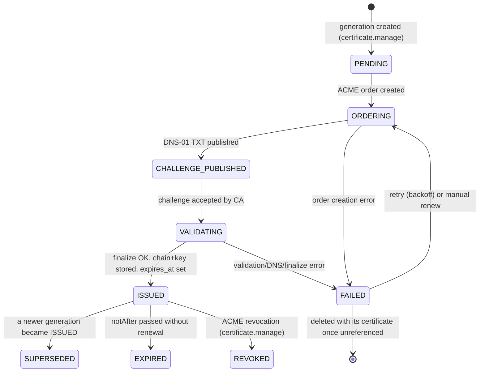

# Certificate Management — NexusOps

**Status:** Subsystem overview. **Phase 5.1 shipped** — the `certificates` and
`certificate_generations` tables, the pre-issuance lifecycle, the two permission
codenames with their role matrix, and the metadata-only certificate API (commit
`37b7211`, migration `c8d9e0f1a2b3`). **No certificate has ever been issued**: there is
no ACME client, no key envelope, no TLS listener and no HTTPS redirect — the schema has
no `certificate_id` column on `routes` and `routes.scheme` is a closed CHECK of `'http'`
(`backend/app/models/routing.py`). Every remaining shape below is **Phase 5 design**, not
shipped behavior. The authoritative Phase 5 design (architecture, threat model, key
hierarchy, delivery mechanism, slices and acceptance criteria) is
[phase5-design.md](phase5-design.md); this document is the subsystem overview and defers
to it on every decision where the two differ. The **HTTP half** of the surrounding
subsystem — domains, routes, TXT verification, the nginx renderer and the `nginx.*`
operations — **shipped in Phase 4** and is described in
[domain-routing.md](domain-routing.md).
**Date:** 2026-09-21 (status updated 2026-10-12: Phase 5.1 shipped)
**Companions:** [phase5-design.md](phase5-design.md) · [domain-routing.md](domain-routing.md) · [domain-model.md](domain-model.md) · [multi-tenancy.md](multi-tenancy.md) · [authorization.md](authorization.md) · [node-agent-architecture.md](node-agent-architecture.md) · [secrets-architecture.md](secrets-architecture.md)

## 1. Scope and current state

**Shipped (Phase 4):** the domains and routes tables (tenant RLS plus the
platform-unique verified-name index), TXT ownership verification with the
STALE → UNVERIFIED grace lifecycle and its sweeps, the nginx renderer, the three
`nginx.*` operations, and the agent-side nginx provider with atomic apply and
rollback — **HTTP only**. See domain-routing.md §1.

**Shipped (Phase 5.1, 2026-10-12):** certificate *identity and lifecycle metadata* —
the `certificates` table (domain association, canonical primary CN, SANs, challenge
type, renewal preference, key algorithm, expiry and last-error fields), the
`certificate_generations` table limited to the pre-issuance states, the derived
certificate status, organization-scoped RLS on both tables, the
`certificate.read`/`certificate.manage` codenames with the role matrix in §3, and the
metadata-only API (request, list, inspect, update the renewal preference, delete an
unissued request). Creating a certificate records a request and its first generation;
it issues nothing, delivers nothing and activates nothing, and the API says so
(`issued: false`, `current_generation_id: null`, `expires_at: null`). See
phase5-design.md §1.1 and §10.1.1.

**Shipped since (5.2.1):** the **key envelope** — the `KEKProvider` seam, the Vault
Transit adapter, the explicitly selected deterministic test/dev provider, the
operation-scoped organization DEK (`organizations.dek_ciphertext` + `dek_generation`,
wrapped and never stored in plaintext), provider health reporting, and the KEK-rotation
rewrap path. The organization/purpose/generation binding travels as the derivation
context of a `derived=true` transit key (phase5-design.md §6.7 amendment). **It protects
nothing yet** — no certificate material exists in the database for it to wrap — so its
value here is structural: the custody path is built and tested before the first key it
will hold.

**Not shipped (the rest of this document):** `dns_providers` and its credential storage,
`acme_accounts`, and therefore **any** ACME
issuance, DNS-01 publication, private-key delivery, installation, HTTPS activation,
renewal, expiry monitoring or revocation. `routes.scheme` cannot be set to `https` and
there is no `certificate_id` column, so an HTTPS route is not merely unwired — it is
unrepresentable until Phase 5.5 adds it by migration. No certificate key, chain or
ciphertext column exists anywhere in the schema, which is why an `ISSUED` generation
cannot be written: its state is not in the database's vocabulary. The only TLS anywhere
today is the dashboard edge documented in docs/deployment.md, which terminates the
*dashboard's* own TLS, not customer traffic (domain-routing.md §1).

**v1 constraint, stated where HTTPS is promised:** issuance is DNS-01 only, and v1's
DNSProvider implementation is **Cloudflare only** — v1 HTTPS requires the domain's
DNS hosted on Cloudflare plus a scoped API token; other DNS providers are later
phases. This constraint is surfaced in the add-domain UI flow (platform-vision.md §4
prerequisite list) as a prompted setup step with token-scope instructions — never
discovered at certificate-request time.

What exists and is reused:

| Existing capability | Ground | Reuse here |
|---|---|---|
| Fernet helpers `encrypt_str` / `decrypt_str` / `digest_of` | `backend/app/core/security.py` | Encrypt cert chain + private key at rest; display fingerprint |
| Fernet-ciphertext-at-rest precedents | `secrets.ciphertext` (`models/secrets.py`), `server_credentials.secret_ciphertext` (`models/infra.py`), `notification_channels.config_ciphertext` (`models/notify.py`) | Same pattern for cert columns and DNS-provider credentials |
| Metadata-only reads for secret-like resources | `secret_service._detail` (`app/services/secret_service.py`), channel config write-only (`notification_service`) | Certificate API never returns key material |
| Recursive, PEM-aware redaction | `core/logging.py` — `redact_mapping` / `redact_text` / `redact_value` / `redact_log_event` (Phase 4.4: dicts, lists and tuples at any depth **and** PEM-armor content matching), applied at write in `audit_service.record` | Defense-in-depth on every leak path — **not** a license to put keys in an unsafe data path (phase5-design.md §7) |
| Beat cadences + atomic claims | `celery_app.py` `beat_schedule`; claim pattern `monitor_service` (`FOR UPDATE SKIP LOCKED`) | Renewal sweep, stuck-state sweep |
| Incident/alert pipeline | `incident_service`, `alert_service` | Issuance/expiry failures open incidents |
| Append-only audit | `audit_service.record` + DB trigger | `certificate.*` actions |
| Agent auth (`X-Agent-Token`, SHA-256 lookup) | `api/v1/agent.py` (`require_server`) | Authenticated channel for delivery ops |
| Pull-based operation control plane | shipped in Phase 1/3 — `operations` table, CAS claim/result, closed whitelist | `certificate.install` / `certificate.remove` op types (Phase 5, reference-only params) |

Honesty labels: the operations framework this document leans on **is real and shipped**
(Phase 1/3, node-agent-architecture.md §5) — it is not a spec. The certificate
subsystem's *issuance* half is **not built**: no ACME client, no key envelope, no key or
chain column. The certificate *record* shipped in Phase 5.1 (`certificates` and
`certificate_generations`, metadata only — §1). Earlier drafts' `Connection`/`Integration`
entity for DNS credentials does not exist in the tree; [phase5-design.md](phase5-design.md)
§3.4/§5.3 decides a dedicated `dns_providers` table instead, and no provider table or
row exists yet.

## 2. Certificate entity

**Partly in the schema (Phase 5.1: identity and pre-issuance lifecycle only; every
material/issuance column below is still design).** The shipped Route table has no
`certificate_id` column and
`scheme` is a closed CHECK of `'http'` (`backend/app/models/routing.py`); Phase 5 adds
the column and widens the CHECK by migration. The design is that a Route carries an
optional `certificate_id`, so one certificate may serve many routes while a route
binds at most one (the spine ER line `Route |o--o| Certificate` understates this to
0..1:0..1; the Route table is authoritative). One row per requested certificate.

**Generation model (decided in phase5-design.md §3.2).** A certificate row is the
*identity*; each ACME order + key pair is a separate **generation** row
(`certificate_generations`, unique `(certificate_id, generation)`, at most one
non-terminal generation per certificate). Renewal inserts a new generation and marks
the old `SUPERSEDED`; it does **not** overwrite the material in place. Earlier drafts
of this document said renewal reuses the row and replaces `chain_ciphertext` — that is
corrected: keeping generations separate is what makes "an older generation must not
replace a newer one" a structural property rather than a comparison the code must
remember.

| Field | Type | Notes |
|---|---|---|
| `org_id` | UUID FK, NOT NULL | Tenant root; session guard applies (multi-tenancy.md §3) |
| `primary_cn` | String | Subject CN, e.g. `api.example.com` or `*.example.com` |
| `sans` | JSONB list | Additional identifiers on the order (e.g. apex + wildcard) |
| `status` | String + CHECK | Certificate-level view: `PENDING`/`ISSUED`/`FAILED`/`EXPIRED`/`SUSPENDED`/`REVOCATION_PENDING`/`REVOKED`/`REVOKED_LOCAL_ONLY`; `state` (material) and `revocation_state` (CA) are separate axes (phase5-design.md §2.2/§9.3) |
| `challenge_type` | String + CHECK | `dns-01` only in v1; `http-01` is a later fallback, not offered (phase5-design.md §5.2/§5.7) |
| `auto_renew` | Bool | Renewal scan skips rows with false |
| `dns_provider_id` | UUID FK → `dns_providers` | DNSProvider creds for DNS-01; defaults from the Domain (phase5-design.md §3.4/§5.3) |
| `issued_at`, `expires_at` | DateTime | From the issued cert's notBefore/notAfter |
| `chain_ciphertext` | Text | Fernet(**org DEK**, phase5-design.md §6) of `fullchain.pem` — on the generation row, not the certificate row |
| `key_ciphertext` | Text | Fernet(**org DEK**) of `privkey.pem` — generation row |
| `fingerprint` | String | SHA-256 of the leaf DER — display + change detection, never a decryption oracle (like `digest_of`) |
| `order_state` | JSONB | ACME order/challenge URLs, key authorizations, TXT record refs (public ACME data, no keys) |
| `last_error` | Text nullable | Sanitized failure reason of the current generation's last attempt |
| `next_attempt_at` | DateTime nullable | Backoff cursor for failed attempts |
| `attempt_count` | Int | Reset to 0 on success; drives backoff + give-up |

> **Ownership note:** the ciphertext columns, `fingerprint`, `order_state` and the
> attempt cursors live on `certificate_generations` (one ACME order + key pair), not on
> `certificates`. `certificates` holds identity (`primary_cn`, `sans`,
> `dns_provider_id`, `auto_renew`) and a denormalized `status`/
> `current_generation_id`/`expires_at`. Full column/index/constraint list:
> phase5-design.md §3.

Certificate **status** is a denormalized view of the current generation; the status
machine below describes a single **generation** (phase5-design.md §2.2), which is what
renewal creates and supersedes. Renewal does not re-enter `validating` on the same row:



Certificate is referenced by `routes.certificate_id` (domain-model.md §2.4). A
certificate row is never hard-deleted while any route references it (RESTRICT, same
policy as roles); delete is allowed only when orphaned.

## 3. API surface and permissions

Codenames per authorization.md §2: `certificate.read`, `certificate.manage` —
**registered in Phase 5.1** (`backend/app/core/permissions.py`, seeded into the stored
roles by migration `c8d9e0f1a2b3`). **Role matrix (implemented):** with the
current stored role names (the `Operator` → `DevOps` rename is *not* shipped),
Owner/Admin/**Operator** hold `certificate.read` + `certificate.manage`, and
Developer/Viewer hold `certificate.read` only. Both are organization-scoped, and reads
remain **metadata-only** — no endpoint returns a private key, plaintext certificate
material or ciphertext (phase5-design.md §4.1). No `node.execute` is introduced;
delivery rides whitelisted Operation types (§6) gated by `certificate.manage` +
the `nginx` capability.

| Endpoint | Gate | Behavior |
|---|---|---|
| `POST /certificates` | `certificate.manage` | Create row, enqueue issuance |
| `GET /certificates` | `certificate.read` | Metadata-only list (org-scoped) |
| `GET /certificates/{id}` | `certificate.read` | Metadata + fingerprint + status + expiry; **no ciphertext, ever** |
| `POST /certificates/{id}/renew` | `certificate.manage` | Force reissue outside the window |
| `POST /certificates/{id}/revoke` | `certificate.manage` | ACME revocation; delivers removal ops |
| `DELETE /certificates/{id}` | `certificate.manage` | Only when no routes reference it |
| `GET /certificates/{id}/routes` | `certificate.read` | Routes serving this cert (= delivery targets) |

All routes run under `X-Org-Id` resolution and the session guard (multi-tenancy.md §2-3);
every mutation audits (§12).

## 4. ACME architecture

**The control plane is the ACME client.** Issuance runs in the API/Celery worker, never
on nodes. Rationale: DNS API creds never leave the control plane; rate-limit state is
tracked in one place; NAT-ed nodes cannot answer challenges themselves; key generation
and storage are centralized.

### 4.1 DNS-01 first (the default and the wedge)

DNS-01 is the only challenge type in v1 because it is the only one that works for the
platform's wedge (platform-vision.md §2.2): home servers behind NAT with no inbound
port 80, Raspberry Pis, and wildcard names. It requires no inbound connectivity to the
node at issuance time — the proof is a TXT record, not an open port.

### 4.2 DNSProvider interface

Providers over couplings (platform-vision.md §3.6). One interface, first implementation
Cloudflare:

| Method | Purpose |
|---|---|
| `create_txt(zone, name, value, ttl)` | Publish `_acme-challenge.<name>` |
| `delete_txt(zone, name, value)` | Cleanup after validation (best-effort) |
| `propagation_check(name, value, deadline)` | Query authoritative NS before telling ACME "ready" |
| `verify_creds()` | Health check on save |

- Credentials live in the dedicated **`dns_providers` table** (`org_id`, `name`,
  `kind`, `credentials_ciphertext`, `credential_fingerprint`, `scopes`,
  `zone_allowlist`, `verified_at`) — Fernet(**org DEK**)-encrypted whole, write-only via
  the API, metadata-only reads: the pattern proven by notification channel config and
  secret metadata. A Cloudflare API token **scoped to the zone** is the v1 credential
  shape, and `zone_allowlist` is enforced before any provider call. Rationale for a
  dedicated table (vs reusing deployment-resolvable secrets or a notification channel)
  and cleanup/validation rules: phase5-design.md §3.4/§5.3. **A customer DNS token must
  never be delivered to a node.**
- The Domain row carries `dns_provider_id` (domain-model.md §2.4); a certificate may
  override it for the challenge.
- Later implementations (Route53, DigitalOcean, ...) add a class, a kind enum value,
  and nothing else.

### 4.3 ACME account and directory

- Directory URL is configuration: Let's Encrypt production plus **staging**, which is
  the default for all non-production environments and for tests — staging exempts
  development from production rate limits. **Staging is the default; production
  issuance requires explicit production configuration and never silently falls back to
  staging**, and a staging-issued certificate is never presented as a production one
  (phase5-design.md §5.4).
- One ACME account per Organization per directory (staging and production are
  separate accounts). The account key is generated control-plane-side on first use and
  stored in a dedicated `acme_accounts` row (`org_id`, `directory_url`, `account_url`,
  `key_ciphertext` Fernet(**org DEK**)). Per-org accounts keep rate-limit blast radius
  and revocation ownership scoped to the tenant (phase5-design.md §5.4).

### 4.4 HTTP-01 via node nginx (later fallback)

HTTP-01 requires Let's Encrypt to reach the node on port 80 — it serves only nodes with
public DNS + inbound 80, and cannot issue wildcards. It is a **later-phase fallback**
for orgs that do not want to hand out DNS API credentials: the control plane renders a
temporary challenge location into the node's nginx config via the existing nginx
render/apply operation path (ProxyProvider, domain-model.md §2.4; spec:
node-agent-architecture.md), the node answers the probe, and the flow proceeds
identically from finalization onward. DNS-01 remains the default; no UI promotes
HTTP-01 in v1.

## 5. Issuance flow

`request → order → challenge → issue → store → deliver`. One Celery task per attempt,
idempotent, driven by the row's status + `next_attempt_at`.

```mermaid
sequenceDiagram
    participant U as DevOps (certificate.manage)
    participant A as API
    participant W as Celery worker
    participant AC as ACME (Let's Encrypt)
    participant DNS as DNSProvider (Cloudflare)
    participant AG as Node agent

    U->>A: POST /certificates (cn, sans, dns_provider_id, auto_renew)
    A->>A: Certificate row status=pending + audit certificate.created
    A->>W: enqueue nx.issue_certificate
    W->>AC: newOrder (identifiers)
    W->>W: load org ACME account (Integration, Fernet)
    AC-->>W: order URL + dns-01 challenges (token, key authz)
    W->>DNS: create_txt(_acme-challenge.<name>, digest)
    W->>DNS: propagation_check until authoritative NS answer
    W->>AC: challenge ready (notify)
    W->>AC: poll order status
    AC-->>W: valid
    W->>AC: finalize (CSR)
    AC-->>W: certificate chain
    W->>W: encrypt_str chain+key -> ciphertext columns; expires_at; fingerprint
    W->>W: status=issued, audit certificate.issued
    W->>W: delivery fan-out (section 6)
    Note over AG: agent PULLS ops; no push, no tunnel
    AG->>A: GET next operation (X-Agent-Token)
    A-->>AG: certificate.install payload (chain + key, over agent TLS)
    AG->>AG: write key 0600 / chain 0644, render nginx, nginx -t, atomic apply
    AG->>A: report result
    A->>A: audit certificate.deployed (per node)
```

Failure at any ACME/DNS step writes `last_error` (sanitized), sets `next_attempt_at`
with backoff, and keeps the row in `failed` on give-up (§11).

## 6. Delivery to serving nodes

**Secret minimization.** The delivery target set is derived, never configured:
`routes` where `certificate_id = cert.id` and `enabled = true` — their distinct
`node_id`s. A node receives a certificate only if it serves a route using it
(domain-model.md §3.7). Adding a route to an already-issued certificate enqueues one
delivery; removing the last route using it on a node enqueues a `certificate.remove`.

Delivery is an **Operation** (whitelisted type — the agent pulls; no remote shell):

| Op type | Params (at rest) | Effect on node |
|---|---|---|
| `certificate.install` | `{certificate_id, generation, fingerprint}` — reference only | Material is fetched from the dedicated delivery endpoint (below); writes `privkey.pem` 0600, `fullchain.pem` 0644 under a **content-addressed** `/etc/nexusops/tls/<fingerprint>/`; then the existing `nginx.apply` path renders the TLS block and applies it atomically with rollback |
| `certificate.remove` | `{certificate_id, generation}` | Drops the generation's managed directory; applies a config without it |

Key property: **private key material is never persisted in the Operation row, its
params, its result, events, audit metadata or logs.** Params hold a reference. The
material is served by a **dedicated, narrowly scoped endpoint** —
`POST /agent/certificates/{delivery_id}/material`, bound to the authenticated node and
its organization, to the specific certificate/generation, and to a bounded recovery
window; the body is assembled at read time (`decrypt_str(key_ciphertext)` inside the
request) with `Cache-Control: no-store`, and is never stored. Op results carry
success/failure and a fingerprint only. Full mechanism, replay/supersession rules and
leak-path table: **phase5-design.md §7**. Redaction (`core/logging.py`) is
defense-in-depth, not the control.

**Issuance success is not activation.** A certificate can be `ISSUED` at the control
plane while every serving node is offline. The platform reports six distinct stages —
issued, delivered, installed, applied, verified, active (phase5-design.md §2) — and
never equates issuance with a working HTTPS endpoint.

Failure semantics: the op retries while the node is offline (standard Operation queue
behavior, node-agent-architecture.md); a cert whose deliveries are all pending shows
`issued` but the routes page surfaces delivery state per node. HTTP keeps serving until
the HTTPS endpoint has been independently verified (phase5-design.md §5.6).

## 7. Renewal

A beat-driven sweep, built on the platform's existing cadence pattern
(celery_app.py:47-93 fixed ticks; atomic claim via `FOR UPDATE SKIP LOCKED`,
monitor_service.py:293-313):

| Beat entry | Cadence | Work |
|---|---|---|
| `sweep-certificates` | hourly | Claim certificates `auto_renew AND current generation ISSUED AND not_after < now() + 30 days`; enqueue a **new generation** (same flow as §5) |
| `retry-failed-certificates` | hourly | Claim `status=failed AND next_attempt_at <= now()`; re-enqueue with backoff |

Renewal creates a **new generation** (new ACME order + new key pair) and marks the
previous generation `SUPERSEDED`, in one transaction; then it re-runs delivery to the
currently-derived target set. The old material stays installed and serving on nodes
until the new one is delivered and applied, since renewal starts 30 days before
expiry. An older generation can never replace a newer one: the generation is immutable
once issued, paths are content-addressed by fingerprint, and a `SUPERSEDED` generation
refuses delivery (phase5-design.md §8.5). A node that is offline during renewal stays
`PENDING` and converges on its next heartbeat — the state is visible, not a silent
success (phase5-design.md §8.6).

- **Failure alerts + incident.** An attempt that exhausts its budget (§11) raises
  `certificate.failed` → CRITICAL alert via the existing alert mapping
  (alert_service.py:17-29) and opens an incident through the incident pipeline
  (incident_service.py:104-246); resolution happens automatically when a later attempt
  succeeds, mirroring monitor auto-resolve (monitor_service.py:377-397).
- **Expiry breach.** If `expires_at` passes with renewal still failing, the sweep sets
  `status=expired` — a CRITICAL state surfaced by the TLS-expiry monitor (§10) rather
  than a second incident path.
- Manual `POST /certificates/{id}/renew` bypasses the 30-day window for ops drill-down;
  it is audited like any issuance.

## 8. Wildcard certificates

- **DNS-01 only.** Let's Encrypt validates wildcard identifiers exclusively via DNS-01;
  HTTP-01 cannot issue them. A wildcard request with `challenge_type=http01` is
  rejected at create time.
- **One label deep.** `*.example.com` matches `api.example.com` but not
  `a.b.example.com`. The common v1 shape is a single order for both identifiers —
  `sans = ["example.com", "*.example.com"]` — so apex and any first-level subdomain
  share one cert; both identifiers validate via their own `_acme-challenge` TXT record
  (the DNSProvider interface takes the full challenge name, so no special casing).
- **Route binding.** A route's hostname may bind a certificate whose CN/SANs cover it.
  Matching is exact-or-wildcard; this subsystem owns both the covering check and the
  reject-on-mismatch at bind time (Open question 3).
- **Renewal and delivery are identical** to non-wildcard certs — the wildcard lives in
  the identifiers, not the pipeline. Serving a wildcard from a node means every route
  on that node using the covered name shares one key; delivery minimization (§6)
  already collapses that to one install op per node.

## 9. Storage and leak paths

**Phase 5 target (not the current secret-store path):** certificate and DNS-credential
ciphertext is Fernet under a **per-organization DEK**, itself wrapped under
`ENCRYPTION_KEY` (the KEK) and stored on the organization row. `decrypt_str` fails
closed on a mismatch. This does **not** re-encrypt the existing secret store — secrets,
`secret_versions`, `server_credentials` and channel configs keep the current single-key
path (`backend/app/core/security.py`), and migrating them is a separate reviewed change.
The full key hierarchy, threat model, rotation, backup and recovery rules are in
**phase5-design.md §6**; in particular, a per-org envelope does **not** bound a
compromise of the KEK or of the application runtime.

| Path | Guarantee | Enforcement |
|---|---|---|
| REST responses | Metadata only: CN, SANs, status, dates, fingerprint — **no ciphertext field** | Schemas define no ciphertext field (pattern: `secret_service._detail` metadata-only) |
| Operation rows at rest | Reference `{certificate_id, generation, fingerprint}` only, no key material | §6; the dedicated material endpoint assembles the body at read time |
| Operation results / history API | success/failure + fingerprint only | Op result schema; params *are* reference-only, so the history endpoint is safe by construction |
| Logs | No PEM/key contents | Phase 4.4 recursive, PEM-aware redaction (`core/logging.py`) runs on every structlog record — **defense in depth**; issuance code never logs payload values |
| Audit metadata | No key material | `redact_mapping` applied at write (`audit_service.record`); audited actions carry ids + fingerprint only |
| WS / events | No cert channel publishes material | `certificate.*` event frames carry ids, status, node ids (event_bus frame shape) |
| Frontend | types carry metadata fields only | Hand-mirrored types.ts gains no ciphertext field |
| DB at rest | `chain_ciphertext`, `key_ciphertext` Fernet(org DEK) columns **on the generation** | §2/§9; read paths limited to issuance write + the delivery endpoint's read |

`fingerprint` (SHA-256, truncated) is the only value-derived field any API returns —
display/change-detection use, never a decryption oracle, same reasoning as
`digest_of` (`backend/app/core/security.py`).

## 10. Status/expiry tracking and monitor tie-in

- `expires_at` is set from the issued cert's `notAfter` at store time. The
  `sweep-certificates` pass also flips `issued` → `expired` when it passes, and marks
  orphaned `failed` rows deletable.
- **TLS-expiry monitors.** domain-model.md §2.6 makes Monitor polymorphic
  (target node/container/domain/certificate/url) with auto-attach on domain routes
  (opt-out). Every certificate gets one `certificate`-target monitor on issuance:
  the check is `days_remaining = expires_at - now()` evaluated against warning/critical
  thresholds (default warn 21d, critical 7d) and rides the existing engine —
  check scheduling, incident open/acknowledge/resolve, notification fan-out are all
  unchanged monitor machinery, not new code. Dedup: the certificate-target monitor is
  the expiry-tracking owner — the TLS-expiry monitor a route's auto-attach would create
  (domain-model.md §2.6) is skipped when the route's bound certificate already has its
  issuance-time monitor, so a cert serving routes ends up with a single expiry monitor
  and a route-less cert is still covered by its own.
- Uptime monitoring of the *served* hostname is the domain/route monitor's job
  (domain-model.md §2.6); certificate expiry and route availability fail independently
  and page through the same incident pipeline.
- The certificate detail page renders the monitor's state inline; Viewer
  (`certificate.read`) sees it read-only.

## 11. Failure handling

Attempt budget: 5 attempts per issuance/renewal cycle, exponential backoff
(`2^n * 5 min`, cap 24h — same shape as the notification retry ladder,
notification_service.py:44-46). Exhaustion → `failed`, alert + incident (§7).

| Failure class | Detection | Handling |
|---|---|---|
| DNS API auth/permission error (Cloudflare 403, revoked/under-scoped token) | `create_txt` / `verify_creds` status | Attempt fails with a classified reason surfaced in `last_error` and the UI; no retry until the Integration is fixed — backoff still applies so fixing the token heals automatically |
| DNS API outage (5xx / timeout) | Provider call | Retry with backoff; propagation_check has a hard deadline so a slow API cannot hang the worker |
| Propagation never visible | Authoritative-NS poll deadline | Fail attempt, best-effort `delete_txt` cleanup, retry |
| ACME validation rejected (bad TXT, CAA, challenge mismatch) | Order status invalid | Fail attempt; retry only after cleanup — re-setting the same wrong record wastes the per-name failed-validation budget |
| Let's Encrypt rate limits (new-orders per account window, duplicate-certificate per week, failed validations per hostname/hour) | ACME error type + `Retry-After` | Honor `Retry-After` exactly; suppress retries beyond the budget; staging directory for all pre-production use keeps production budget clean |
| Order/account errors (expired order, rejected account key) | ACME status | Account errors re-run registration (new keypair Integration) once; otherwise fail |
| Stuck `validating` (worker died mid-order) | Stuck-state sweep: `validating` with no heartbeat older than order TTL (~1h) | Sweep marks `failed` with reason, best-effort TXT cleanup, normal backoff resumes |
| Stuck deliveries (node offline) | Operation queue | Ops retry while node offline; `certificate.remove` for a decommissioned node is dropped by the op sweeper (node gone, nothing to remove) |
| DEK/KEK mismatch at decrypt | `decrypt_str` ValueError | Delivery fails closed — the endpoint reports failure, never ships a broken payload; a generation whose material cannot be decrypted is re-issued (§6.5) |

No partial state: a generation's ciphertext columns are written in one transaction and
never rewritten (renewal inserts a new generation), and node files are written to temp
paths then atomically moved only after `nginx -t` passes (the shipped Phase 4
stage → validate → backup → swap → reload → rollback pipeline,
phase5-design.md §8.4).

## 12. Audit and events

Audit actions (append-only, org-attributed once tenancy lands, named per the
`resource.action` convention in domain-model.md §2.6):

| Action | On | Actor |
|---|---|---|
| `certificate.created` | Create | user |
| `certificate.issued` | Chain stored | system (worker) |
| `certificate.renewed` | Renewal chain stored | system (worker) |
| `certificate.failed` | Attempt budget exhausted | system (worker) |
| `certificate.deployed` | Node reports install success | agent |
| `certificate.removed` | Node reports removal | agent |
| `certificate.suspended` | Ownership lost / operator suspension | system (worker) / user |
| `certificate.ownership_lost` | Cross-org ownership flip affecting this cert | system (worker) |
| `certificate.split` | Shared cert replaced/split before revocation | system (worker) |
| `certificate.revocation_requested` | Revocation queued (automated or manual) | system / user |
| `certificate.revoked` | ACME revocation acknowledged | system / user |
| `certificate.revocation_failed` | CA unreachable/rejected at the retry budget | system (worker) |
| `certificate.deleted` | Row deleted | user |

SystemEvent equivalents (`certificate.issued`, `certificate.renewed`,
`certificate.failed`, `certificate.deployed`) go through `event_bus.publish` with
ids/status/fingerprint only (§9), giving the events feed and a future
`org:{org_id}:certificates` WS channel everything the UI needs without a leak path.
`certificate.failed` additionally drives the alert/incident path (§7).

## 13. Non-goals

- No ACME client on the node — the node never talks to Let's Encrypt.
- No custom CA / private PKI in v1 (the ACME provider abstraction would accept a
  private ACME server directory later).
- No SNI-only multi-cert-per-route serving in v1: one certificate per route.
- No node-side key generation in v1 — the control plane generates and holds the key.
- No re-encryption of the **existing secret store** under the org DEK; that is a
  separate reviewed change (phase5-design.md §6.4). KEK *re-wrap* of org DEKs is
  designed for the Phase-5 scope only (§6.3).

## Open questions — resolved (see phase5-design.md Appendix A)

These were the open questions in earlier drafts. They are now **decided** in the
authoritative Phase 5 design; recorded here so the two documents agree.

1. **ACME client library vs minimal implementation** — **library** (`acme` +
   `josepy`) behind an `AcmeProvider` seam; a hand-rolled RFC 8555 client is rejected
   (phase5-design.md §5.1).
2. **Per-org vs single platform ACME account** — **per-org per-directory** account
   (§5.4).
3. **Wildcard-vs-exact matching at route bind time** — exhaustive covering check owned
   by the certificate service; error `CERTIFICATE_DOES_NOT_COVER_HOSTNAME` (§4.4).
4. **Renewal window vs shorter-lived certs / ARI** — fixed 30-day sweep in v1; the
   **generation** model leaves room for an ARI-driven second trigger without a schema
   change (§3.2, §9.1).
5. **Delivery pull-response persistence** — resolved by **not** persisting: a
dedicated material endpoint assembled at read time, `Cache-Control: no-store`, bounded
   recovery (§7). Ordinary operation params/result/history stay reference-only.

**Decided in the Phase 5.0 finalization (2026-10-12):**

6. **Centralized TLS key custody** — accepted **conditionally**, with the global
   KEK's blast radius, a preferred external KMS/secret-manager integration, access
   restrictions, rotation, backup recovery and production-readiness conditions
   (C1–C6) recorded in phase5-design.md §1.5/§6.6. Per-org DEKs do **not** bound a KEK
   or application-runtime compromise and are not claimed to.
7. **ACME staging by default**; production issuance requires explicit production
   configuration and never silently falls back to a staging certificate (§4.3 above,
   phase5-design.md §5.4).
8. **Ownership loss triggers automated CA revocation after confirmed loss**, subject
   to a certificate-impact safeguard: a shared multi-identifier certificate is
   **replaced/split before revocation**, and CA revocation **never blocks removal** of
   the old configuration (phase5-design.md §9.3/§9.5).
9. **Certificate role matrix** — Owner/Admin/Operator (`certificate.read` +
   `certificate.manage`), Developer/Viewer (`certificate.read`), with the current stored
   role name `Operator`; organization-scoped and metadata-only reads (§3,
   phase5-design.md §4.1).

Remaining open items for Phase 5.1 and beyond are listed in phase5-design.md §10.3.3.
